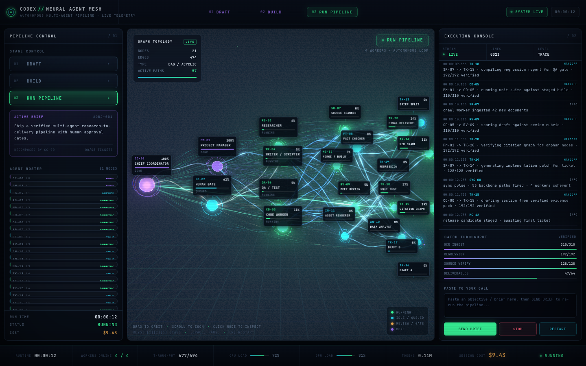

# Neural Agent Mesh

[](https://github.com/guyue55/neural-agent-mesh/actions/workflows/ci.yml)
[](LICENSE)
[](https://threejs.org/)
[](https://guyue55.github.io/neural-agent-mesh/)

A **Three.js neural-style visualizer** for multi-agent workflow state. It renders a 21-node, 474-edge directed acyclic handoff graph as a glowing 3D neuron network, with a live console showing agent progress, task handoffs, verification gates, log stream and rolling cost.

**[Open the live demo](https://guyue55.github.io/neural-agent-mesh/)** · [中文说明](README.zh-CN.md)



---

## What it is — and what it is not

This repository is a **front-end visualization plus an interactive, running state machine**. It reproduces the *observable* part of an autonomous agent crew: the Chief Coordinator → Project Manager → Workers hierarchy, handoff protocol, layered QA, human approval gate, concurrent workers, throughput counters and cost telemetry.

It is **not** connected to Grok, Codex, OpenAI, or any LLM / agent runtime. Logs, progress, handoffs, tokens and cost are deterministic simulation driven by wall-clock time, designed for demonstration and as a drop-in visual front end. To connect a real system, replace the event source in `src/workflow.js`; the 3D layer and DOM panels consume a plain state object and do not need to change.

## Features

- **21-node layered DAG** — 1 Chief Coordinator, 2 PM / human-gate nodes, 4 online workers, 6 specialists, 8 delivery tickets (`1/2/4/6/8`).
- **474 handoff channels** — 53 primary, 118 cross-tier, 303 parallel paths, strictly acyclic.
- **Single-draw-call GPU ribbon** — all 474 curves merged into one `BufferGeometry`; a custom GLSL shader draws sine-wave distortion, flowing dashes and travelling pulse heads.
- **Handoff pulses** — cubic Bézier flight computed in the vertex shader, zero CPU cost per particle; a network-wide synchronous firing every ~4.6 s.
- **Post-processing** — `RenderPass → UnrealBloomPass → CRT / chromatic aberration / vignette → OutputPass`.
- **Readable labels** — 21 DOM labels with real-size measurement, 2-D collision resolution, nearest-free-slot fallback and horizontal FOV locking so no node is cropped on narrow viewports.
- **Three-panel console** — DRAFT / BUILD / RUN PIPELINE, 21 agent cards, log terminal, throughput counters, cost readout, brief input, STOP / RESTART.
- **Working state machine** — unattended cold start runs BOOT → DRAFT → BUILD → RUN, fires handoffs, opens a human gate, accepts a custom brief, and loops.
- **Fully offline** — Three.js r180 and the 11 addon files it actually uses are vendored under `vendor/`. No CDN, no build step, no network request at runtime.
- **Responsive & resilient** — below 980 px the three panels stack into a scrollable single column (nothing is hidden); the status bar stays pinned and DPR is capped harder on small hi-DPI screens.
- **Graceful degradation** — `prefers-reduced-motion` slows the shader clock and removes CRT decoration; a missing or lost WebGL context shows a readable, content-equivalent fallback instead of a blank canvas; hidden tabs stop GPU work.

## Quick start

Requirements: Node.js ≥ 18 (only for the local static server) and a WebGL2 browser.

```bash
git clone https://github.com/guyue55/neural-agent-mesh.git
cd neural-agent-mesh
npm ci                # only needed for the Playwright verification suites
npm start              # http://127.0.0.1:4173/
```

Then open <http://127.0.0.1:4173/>. Port can be changed with `PORT=8080 npm start`.

> Do **not** open `index.html` via `file://`: ES modules and the import map require an HTTP origin.
> Any static server works, e.g. `python3 -m http.server 4173`.

### Interactions

| Input | Effect |
| --- | --- |
| Click a node / agent card | Open the node inspector |
| Drag / scroll on canvas | Orbit / zoom the network |
| `1` `2` `3` | Jump to DRAFT / BUILD / RUN |
| `Space` | Pause / resume |
| `R` | Restart the pipeline |
| Brief input + Apply | Restart with a custom objective |
| STOP / RESTART | Pause and resume execution |
| Human Gate | Approve to release the queued handoffs |

## Architecture

```
index.html          import map + three-panel DOM shell
styles.css          dark cyberpunk design system
src/config.js       palette, tiers, phase metadata, timing
src/graph.js        deterministic 21-node / 474-edge DAG generator
src/shaders.js      GLSL: ribbon, node shell, halo, particles, grid, CRT
src/scene3d.js      Three.js scene, geometry build, post FX, label projection
src/workflow.js     simulation state machine: handoffs, QA, gate, cost, logs
src/ui.js           DOM binding: roster, logs, HUD, status bar, modals
src/main.js         bootstrap + wall-clock animation loop
server.mjs          zero-dependency local static server
vendor/three/       pinned Three.js r180 + 11 required addon modules
tools/              Playwright verification suites
```

Data flow: `workflow.tick(dt)` mutates a plain state object → `scene3d.syncFromState(state)` uploads only changed attributes (`aEnergy`, `aReveal`, node colors) → `scene3d.update()` animates shaders → `ui.render(state)` updates the DOM. The loop is driven by real elapsed time (clamped), so the pipeline keeps its timing even on low-FPS software WebGL.

## Verification

Four real-browser suites drive a system Chrome (or Playwright Chromium on Linux/CI) with WebGL2 / SwiftShader:

```bash
npm run verify                                  # 31 functional checks + 9 screenshots
npm run verify:viewports                        # 7 viewport sizes, label overlap / clipping
npm run verify:ux                               # 35 UX / resilience checks (see below)
npm run verify:all                              # all three local suites
npm run verify:live -- https://your-host/       # 19 checks against a deployed URL
BASE_URL=http://127.0.0.1:4173/ npm run verify # point the suites at another host
```

`verify:ux` covers 390 px / 900 px / 1024 px / 1440 px layouts, DPR capping, 21 labels with zero overlaps, `prefers-reduced-motion`, a simulated missing WebGL context, `webglcontextlost`, background-tab GPU suspension and document metadata.

Latest results on this codebase: **31/31** functional, **7/7** viewports, **35/35** UX, **19/19** deployed-URL checks; zero console, page, runtime or HTTP errors. Screenshots and machine-readable `report.json` / `ux-report.json` are written to `tools/shots/` (git-ignored).

CI runs the syntax check and the full `verify` + `verify:viewports` + `verify:ux` suites on every push / PR via [`.github/workflows/ci.yml`](.github/workflows/ci.yml).

## Deliberate non-goals & future work

- **No WebGPU / TSL migration (yet).** The latest Three.js is r187 (Oct 2026); this repo deliberately pins the vendored r180 WebGL path. Porting means rewriting every custom `ShaderMaterial` into TSL and replacing `EffectComposer` with the node-based post pipeline. With all 474 edges already merged into a single draw call, WebGPU's main wins (many draw calls, compute shaders) would not repay that risk for a 21-node scene.
- **No security response headers.** GitHub Pages cannot set `Content-Security-Policy`, `Strict-Transport-Security`, `X-Frame-Options` or `X-Content-Type-Options`. The page ships zero third-party scripts and sets a strict `Referrer-Policy` meta; real headers require a CDN/proxy in front or a different host.
- **No live agent backend.** To attach one, emit events following the (still experimental) OpenTelemetry GenAI semantic conventions — `invoke_agent`, `execute_tool`, `invoke_workflow` spans with `gen_ai.*` attributes — and adapt them into the plain state object consumed by `src/workflow.js`. The 3D and DOM layers need no changes.
- **Hidden tabs.** Browsers suspend `requestAnimationFrame` in background tabs. The simulation resumes from wall-clock time on return instead of replaying the whole elapsed interval.
- **Optional hardening not applied:** SHA-pinned GitHub Actions, CodeQL / OpenSSF Scorecard, signed releases and branch protection. They are reasonable next steps for a repository with multiple contributors, but add CI surface without changing the delivered site.

## Deploying

The site is pure static. GitHub Pages is served from the `main` branch root; `.nojekyll` disables Jekyll processing. Any static host works — all asset URLs are relative, so a sub-path deployment (e.g. `/neural-agent-mesh/`) is supported. No build command and no environment variables are required.

## Contributing

See [CONTRIBUTING.md](CONTRIBUTING.md), [CODE_OF_CONDUCT.md](CODE_OF_CONDUCT.md) and [SECURITY.md](SECURITY.md). Issues and PRs are welcome, especially shader work, accessibility, and adapters that feed real agent events into `src/workflow.js`.

## License

[MIT](LICENSE) © 2026 guyue55. Vendored Three.js files keep their own MIT license headers.
