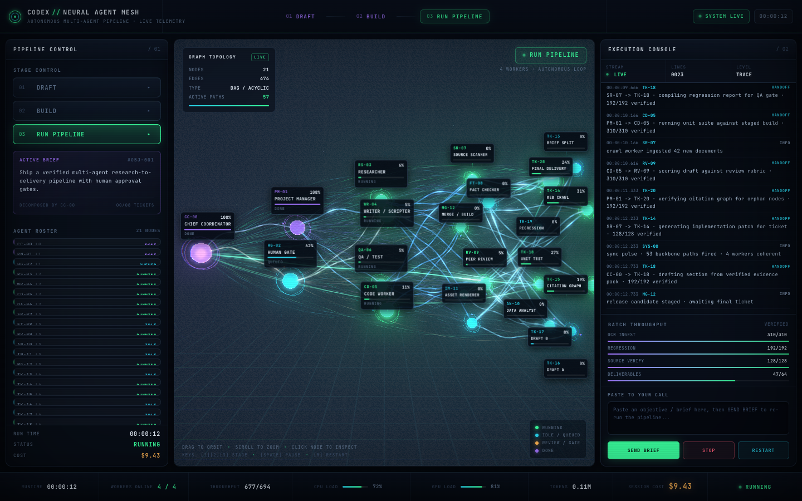

# Neural Agent Mesh · 多智能体神经元可视化

[](https://github.com/guyue55/neural-agent-mesh/actions/workflows/ci.yml)
[](LICENSE)
[](README.md)

用 Three.js 做的**多 Agent 工作流状态可视化前端**：21 个节点、474 条任务交接通道组成发光 3D 神经元网络，配三层控制台实时展示进度、handoff、核验关卡、日志与费用。

**[打开在线演示](https://guyue55.github.io/neural-agent-mesh/)** · [English README](README.md)



## 先说清楚边界

这是**前端可视化 + 可交互的运行状态机**，复现的是「看得见的那套自治班组界面」：首席协调官 → 项目经理 → Worker 三层、任务交接、层层 QA、人工 Gate、并发 worker、吞吐计数与费用滚动。

它**没有接 Grok / Codex / 任何 LLM 或 Agent 框架**。日志、进度、handoff、tokens、费用都是由真实时钟驱动的仿真数据。要接真实系统，只需把 `src/workflow.js` 的事件源换成你的 agent 消息流，3D 层与 DOM 层不用改。

## 主要特性

- **21 节点分层 DAG**：1 协调官 / 2 PM+人工 Gate / 4 在线 Worker / 6 专家 / 8 工单（1/2/4/6/8）。
- **474 条交接连线**：53 主干、118 跨层、303 并行通道，严格无环。
- **单次绘制的 GPU ribbon**：474 条曲线合并成一个 `BufferGeometry`，自定义 GLSL 实现正弦波浪、流动光带与脉冲头。
- **handoff 脉冲**：三次贝塞尔在顶点着色器里计算，逐粒子零 CPU 开销；约每 4.6 秒全网同步放电。
- **后处理**：Bloom 泛光 + CRT 色差/扫描线/暗角。
- **标签不重叠**：真实尺寸测量 + 二维碰撞求解 + 全局空位兜底 + 锁定水平视野，窄窗口下 21 个节点也全部在画面内且不被裁切。
- **三层控制台**：DRAFT / BUILD / RUN PIPELINE、21 张 Agent 卡片、日志终端、吞吐计数、费用、brief 输入、STOP / RESTART。
- **真能跑的状态机**：打开页面无人干预自动 BOOT→DRAFT→BUILD→RUN，自动派发、核验、弹人工审批、循环。
- **完全离线**：Three.js r180 与 11 个实际用到的 addon 固化在 `vendor/`，无 CDN、无构建步骤、运行时零网络请求。

## 本地运行

需要 Node.js ≥ 18（仅用于本地静态服务）和支持 WebGL2 的浏览器。

```bash
git clone https://github.com/guyue55/neural-agent-mesh.git
cd neural-agent-mesh
npm ci          # 仅验证脚本需要
npm start       # http://127.0.0.1:4173/
```

浏览器打开 <http://127.0.0.1:4173/>。换端口用 `PORT=8080 npm start`；也可以用任意静态服务器，例如 `python3 -m http.server 4173`。

> 不要双击 `index.html`：ES module 与 importmap 必须经 HTTP 访问。

| 操作 | 效果 |
| --- | --- |
| 点节点 / 左侧卡片 | 打开节点详情 |
| 画布拖拽 / 滚轮 | 旋转 / 缩放 |
| `1` `2` `3` | 切到 DRAFT / BUILD / RUN |
| `Space` | 暂停 / 继续 |
| `R` | 重启流水线 |
| brief 输入 + Apply | 用自定义目标重跑 |
| STOP / RESTART | 暂停 / 恢复 |
| Human Gate | 审批放行积压交接 |

## 结构

| 文件 | 职责 |
| --- | --- |
| `index.html` / `styles.css` | importmap、三层 DOM 骨架、暗黑赛博朋克样式 |
| `src/config.js` | 配色、层级、阶段元数据、时序参数 |
| `src/graph.js` | 确定性生成 21 节点 / 474 边 DAG |
| `src/shaders.js` | ribbon / 节点光壳 / 光晕 / 粒子 / 网格 / CRT 的 GLSL |
| `src/scene3d.js` | Three.js 场景、几何构建、后处理、标签投影 |
| `src/workflow.js` | 仿真状态机：handoff、QA、Gate、费用、日志 |
| `src/ui.js` | 卡片、日志、HUD、状态栏、弹窗绑定 |
| `src/main.js` | 启动 + 真实时钟动画循环 |
| `server.mjs` | 零依赖本地静态服务器 |
| `tools/` | Playwright 真实验证脚本 |

数据流：`workflow.tick(dt)` 更新状态对象 → `scene3d.syncFromState()` 只上传变化的 attribute → `scene3d.update()` 驱动 shader → `ui.render()` 刷新 DOM。循环按真实时间推进（带上限钳制），软件 WebGL 低帧率下流水线也不会变慢。

## 验证

```bash
npm run verify                                   # 31 项功能检查 + 9 张阶段截图
npm run verify:viewports                         # 7 种视口：标签重叠 / 裁切
npm run verify:live -- https://你的部署地址/      # 19 项线上检查
BASE_URL=http://127.0.0.1:4173/ npm run verify  # 指向其他地址
```

当前结果：**31/31** 功能、**7/7** 视口、**19/19** 线上检查，控制台 / 页面 / 运行时 / HTTP 错误均为 0。截图与 `report.json` 输出到 `tools/shots/`（已 gitignore）。每次 push / PR 由 [CI](.github/workflows/ci.yml) 自动跑语法检查与完整 `verify`。

## 部署

纯静态站点，GitHub Pages 从 `main` 分支根目录提供，`.nojekyll` 关闭 Jekyll。所有资源都是相对路径，支持子路径部署；无需构建命令和环境变量。

## 贡献与许可

见 [CONTRIBUTING.md](CONTRIBUTING.md)、[CODE_OF_CONDUCT.md](CODE_OF_CONDUCT.md)、[SECURITY.md](SECURITY.md)。欢迎 shader 优化、无障碍改进，以及把真实 agent 事件接进 `src/workflow.js` 的适配器。

[MIT](LICENSE) © 2026 guyue55。vendor 中的 Three.js 文件保留其原有 MIT 许可头。
